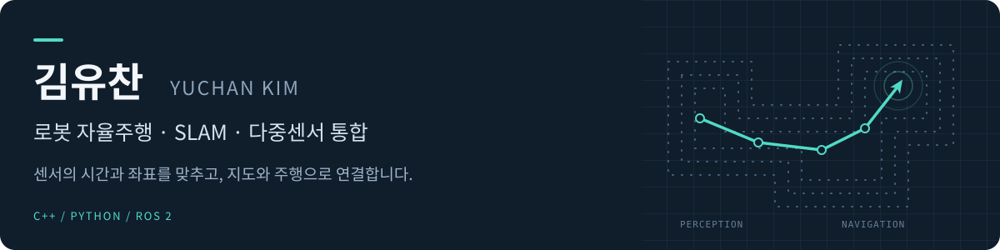
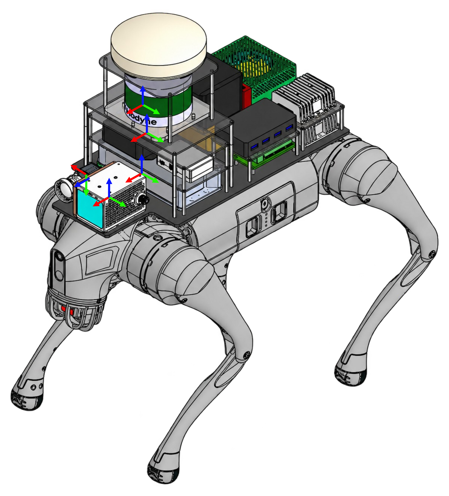

  <picture>
    <source media="(max-width: 600px)" srcset="./assets/overview-banner-mobile.svg" />
    
  </picture>

  <a href="mailto:dbcks30@gmail.com">이메일</a> ·
  <a href="#대표-연구">대표 연구</a> ·
  <a href="#공개-프로젝트">공개 프로젝트</a> ·
  <a href="#기술-역량">기술 역량</a>

## 안녕하세요, 김유찬입니다

**센서의 시간과 좌표를 맞추고, 지도와 로봇 주행으로 연결합니다.**

광운대학교 인공지능응용학과 석사과정에서 **다중센서 취득 시스템, SLAM, 로봇 자율주행**을 연구합니다.
C++·Python과 ROS·ROS 2를 사용해 센서 입력부터 지도 생성, 위치 추정, 실제 로봇 구동까지 연결하는 작업을 해왔습니다.

- **현재 연구** · ROS 2 기반 다중센서 취득, STM32 시간 처리, 센서 캘리브레이션
- **관심 분야** · LiDAR / Visual SLAM, 로봇 Navigation, 센서·소프트웨어 시스템 통합
- **학력** · 광운대학교 석사과정 — 2027.02 졸업 예정 / 선문대학교 스마트자동차공학부 임베디드시스템 전공

## 대표 연구

### 01 · 다중센서 통합 취득 시스템

  

**여러 센서의 데이터를 일관된 시간과 좌표 관계로 활용하기 위한 석사 연구입니다.**

- **구현** · Go2에 Avia·VLP-16·카메라·Xsens IMU를 통합하고, STM32 로컬 시간축과 GNSS의 UTC 대응을 분리한 ROS 2 취득 시스템 구성
- **보정** · IMU 잡음 분석과 카메라–IMU·LiDAR–IMU 캘리브레이션, 점군의 영상 투영을 통한 센서 관계 점검
- **검증** · GNSS 참조 상실·복구 조건에서 원시 취득 연속성 확인, 취득 데이터와 보정값을 FAST-LIO2·FAST-LIVO2 오프라인 지도 생성에 적용

`ROS 2` `STM32` `Kalibr` `LiDAR–IMU Calibration` `FAST-LIO2` `FAST-LIVO2`

### 02 · Go2 실내 자율주행

**지도 생성·위치 추정·경로 계획을 실제 로봇의 속도 제어에 연결했습니다.**

- **담당** · Cartographer·AMCL·Nav2 설정과 Go2 속도 명령 인터페이스 구현
- **확인** · 복도·코너 주행과 장애물에 따른 경로 재계획
- **성과** · KRoC 2026 학술대회 논문 제1저자

`Cartographer` `AMCL` `Nav2` `Unitree Go2` `Jetson AGX Orin`

### 03 · LiDAR 점군 정합 비용함수 비교

**초기 위치와 방향이 달라질 때 정합 비용이 어떻게 변하는지 분석했습니다.**

- **담당** · Point-to-Point·Point-to-Plane·NDT·GICP 비용함수 구현과 시각화
- **분석** · 선택한 점군 쌍에서 초기 회전·병진 변화에 따른 비용함수 특성과 지역 최적해의 영향 비교
- **성과** · KRoC 2026 학술대회 논문 제1저자

`Point Cloud Registration` `NDT` `GICP` `Optimization`

## 공개 프로젝트

연구·공동 프로젝트는 개인 저장소와 Organization에서 관리합니다. 아래는 공개된 구현 저장소이며, 각 프로젝트에서 맡은 역할을 함께 적었습니다.

| 프로젝트 | 구현·기여 내용 |
| :--- | :--- |
| [Go2 개발 환경](https://github.com/YuChani/KWU-Go2) | Go2 관련 ROS 작업공간과 Docker 개발 환경 |
| [CARLA–실물 모형 연동](https://github.com/YuChani/2023-Capstone-Design) | 시뮬레이터의 자세·조향·속도 입력을 실물 모형의 서보·모터 구동에 연결하는 SW 공동개발 |
| [SEA:ME 스케일카 자율주행](https://github.com/YuChani/2024-SEA-ME-HACKATHON) | 센서 처리 결과를 차선 주행·정지 판단에 연결하고 미션 구간 주행 담당 · **팀 대상** |
| [MORAI 자율주행 스터디](https://github.com/YuChani/morai_study) | 카메라·신호등 정보 처리와 경로 추종 관련 Python 구현 |

연구실 Organization → [KWU-CVRL](https://github.com/KWU-CVRL)

## 기술 역량

| 분야 | 사용 기술 |
| :--- | :--- |
| 프로그래밍 | **C++ · Python** |
| 로봇 소프트웨어 | ROS · ROS 2 · Cartographer · AMCL · Nav2 |
| 기하·최적화·영상 처리 | Eigen · Ceres Solver · GTSAM · OpenCV |
| 센서 시간 처리·보정 | STM32 · Kalibr · LiDAR–IMU 캘리브레이션 |
| 개발·실험 환경 | Linux · Git · Docker · CARLA · MORAI · Gazebo |
| 하드웨어 플랫폼 | Unitree Go2 · Jetson AGX Orin · Raspberry Pi |

<b>논문 · 프로젝트 활동 더 보기</b>

### 학술대회 논문

- **LiDAR SLAM을 위한 점구름 정합 조건의 특징 비교 분석** — KRoC 2026, 제1저자
- **실내 환경에서 4족보행로봇의 자율주행기술 개발** — KRoC 2026, 제1저자
- **Visual SLAM을 위한 영상 특징점의 성능 비교 분석** — KRoC 2026, 제2저자 · SIFT·ORB·MASt3R 영상 매칭 비교 공동연구

### 프로젝트·활동

- **체코 글로벌 캡스톤** · ROS 통신·카메라 처리 및 자율주차 제어 SW 공동개발 · 팀 대상, 2024
- **SEA:ME Hackathon** · 스케일카 센서 처리·미션 주행 · 팀 대상, 2024
- **폴란드 글로벌 캡스톤** · CARLA–실물 모형 연동 SW 공동개발 · 팀 금상, 2023
- **경찰대학 치안정책연구소 학생연구원** · MORAI 신호·센서 처리 및 시나리오 평가 지표 인터페이스 개발, 2023
- **선문대학교 자율주행 동아리 회장** · 센서 처리·장애물 회피 스터디 운영, 2023–2025
- 로봇·차량 관련 **등록특허 5건 공동발명**

---

**연락** · [dbcks30@gmail.com](mailto:dbcks30@gmail.com)
